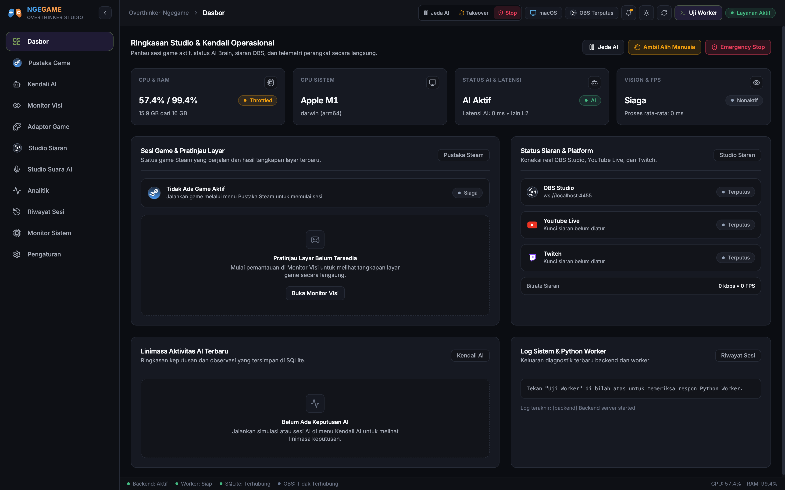
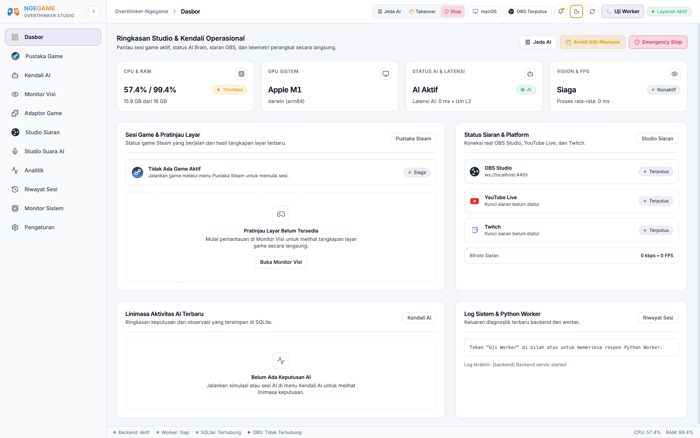
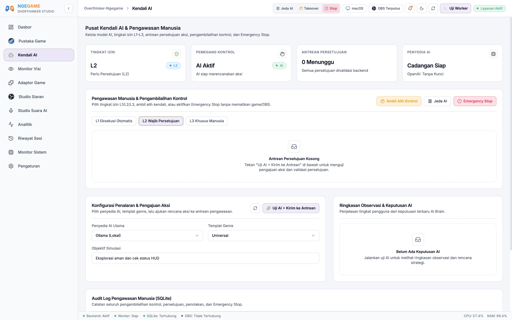
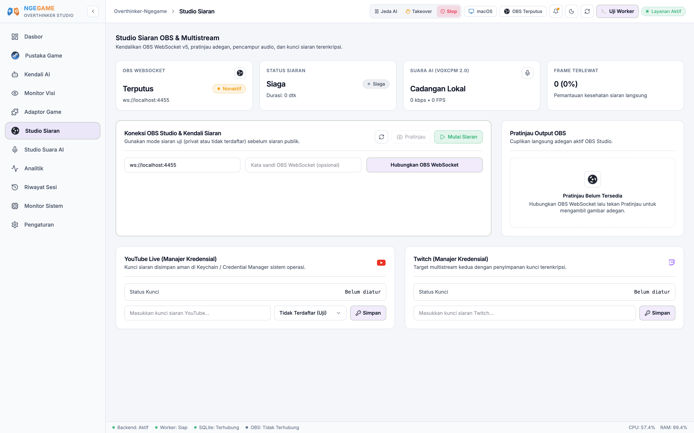

<div align="center">
  
  <h1>Ngegame (Overthinker-Ngegame)</h1>
  <p><strong>AI Gaming Command Center, Real-Time Game Vision &amp; Live Streaming Studio</strong></p>
  <p>
    <code>v0.1.0-prerelease</code> &bull;
    <code>Windows x64 &amp; macOS</code> &bull;
    <code>Electron</code> &bull;
    <code>React</code> &bull;
    <code>TypeScript</code> &bull;
    <code>Node.js</code> &bull;
    <code>Python</code> &bull;
    <code>SQLite</code> &bull;
    <code>Prisma</code>
  </p>
  <p>
    <a href="site/index.html">Landing Page</a> &bull;
    <a href="#panduan-instalasi">Instalasi</a> &bull;
    <a href="docs/USER_GUIDE.md">Panduan Pengguna</a> &bull;
    <a href="docs/WINDOWS_GEMINI_CLI_GUIDE.md">Panduan Windows + Gemini CLI</a> &bull;
    <a href="ARCHITECTURE.md">Arsitektur</a> &bull;
    <a href="CHANGELOG.md">Changelog</a>
  </p>
</div>

**Overthinker-Ngegame** adalah aplikasi desktop *AI Gaming Command Center* dan *Live Streaming Studio* lintas platform (**Windows** dan **macOS**) yang mengintegrasikan deteksi library Steam, tangkapan layar &amp; visi komputer (*OpenCV/OCR*), penalaran AI dengan pengawasan manusia bertingkat (**L1/L2/L3 + Emergency Stop**), sintesis suara **VoxCPM 2.0** Bahasa Indonesia, serta kendali **OBS Studio WebSocket v5** dan manajemen kredensial siaran.

## Daftar Isi

- [Tampilan Aplikasi](#tampilan-aplikasi)
- [Fitur Utama](#fitur-utama)
- [Arsitektur Sistem](#arsitektur-sistem)
- [Tech Stack](#tech-stack)
- [Kebutuhan Sistem](#kebutuhan-sistem)
- [Panduan Instalasi](#panduan-instalasi)
- [Pengembangan Lokal](#pengembangan-lokal)
- [Konfigurasi AI, Steam, Visi, Suara, &amp; OBS](#konfigurasi-ai-steam-visi-suara--obs)
- [Arsitektur Keamanan &amp; Troubleshooting](#arsitektur-keamanan--troubleshooting)
- [Roadmap, Changelog, &amp; Rilis](#roadmap-changelog--rilis)

## Tampilan Aplikasi

| Dashboard (Dark Mode) | Dashboard (Light Mode) |
| :---: | :---: |
|  |  |

| AI Command Center | Streaming Studio |
| :---: | :---: |
|  |  |

## Fitur Utama

- **Overthinker Premium AI Gaming Studio UI**: Antarmuka desktop **Dark Mode** &amp; **Light Mode** berbasis CSS variables dengan 11 halaman terstruktur, **Monitor Sistem**, **Riwayat Sesi** berbasis SQLite nyata, serta kontrol keamanan global di Topbar.
- **Steam Library Manager**: Pemindaian otomatis instalasi Steam lokal (`appmanifest_*.acf`), inspeksi kompatibilitas game, dan peluncuran/penghentian game yang terkontrol.
- **Game Capture &amp; Vision Engine**: Tangkapan layar lintas platform (Windows/macOS) dan pemrosesan frame OpenCV/OCR melalui **Python Worker** (protokol NDJSON).
- **AI Brain &amp; Human Supervision**: Penalaran aksi menggunakan **Ollama** (lokal) atau penyedia **OpenAI-compatible** (cloud) dengan tingkat izin **L1 (Otomatis)**, **L2 (Wajib Persetujuan)**, **L3 (Khusus Manusia)**, *Takeover*, dan **Emergency Stop**.
- **Modular Game Controller &amp; Adaptor**: Mendukung 7 templat genre, adaptor **Universal**, dan adaptor **Stardew Valley** dengan daftar aksi aman (*allowlist*).
- **AI Voice Studio (VoxCPM 2.0)**: Sintesis narasi suara Bahasa Indonesia secara asinkron dengan fallback lokal.
- **OBS Studio &amp; Multistream**: Kendali OBS WebSocket v5 (koneksi, pratinjau adegan, mixer audio, mulai/henti siaran) serta penyimpanan kunci siaran YouTube &amp; Twitch terenkripsi.
- **Telemetri, Auto-Throttling &amp; Backup**: Pemantauan CPU/RAM/GPU real-time, pembatasan beban otomatis, ekspor laporan CSV/JSON, serta backup &amp; validasi integritas SQLite (`PRAGMA integrity_check`).

## Arsitektur Sistem

```text
Electron Desktop Shell (apps/desktop — IPC, Window Guards, Preload Bridge)
  ├── React Frontend UI (apps/renderer — Vite + Tailwind CSS v4)
  └── Node.js Backend API (apps/backend — Express + WebSocket + Prisma/SQLite)
        └── Python Worker (apps/python-worker — OpenCV / OCR / VoxCPM 2.0)
```

Kontrak tipe bersama berada di `packages/shared`. Dokumentasi lengkap tersedia di [ARCHITECTURE.md](ARCHITECTURE.md), [docs/API.md](docs/API.md), dan [docs/DATABASE.md](docs/DATABASE.md).

## Tech Stack

| Lapisan | Teknologi |
| :--- | :--- |
| **Desktop Runtime** | Electron 35+, electron-builder (Windows NSIS x64, macOS DMG/ZIP) |
| **Frontend** | React 19, TypeScript (strict), Vite, Tailwind CSS v4, Lucide Icons |
| **Backend &amp; Database** | Node.js 22+, Express, WebSocket, Prisma ORM, SQLite (`WAL` + `busy_timeout`) |
| **AI &amp; Vision Worker** | Python 3.11+, OpenCV, OCR, VoxCPM 2.0, Ollama / Cloud LLM |
| **Streaming** | OBS WebSocket v5, Windows Credential Manager / macOS Keychain |

## Kebutuhan Sistem

| Komponen | Minimum | Rekomendasi |
| :--- | :--- | :--- |
| **Sistem Operasi** | Windows 10/11 (x64) atau macOS 13+ | Windows 11 x64 / macOS Apple Silicon |
| **Prosesor &amp; RAM** | 4-Core CPU, 8 GB RAM | 8-Core CPU, 16 GB+ RAM |
| **Runtime (Dev)** | Node.js 20+, Python 3.11 | Node.js 22 LTS, Python 3.11 |
| **Pendukung** | OBS Studio 28+ (WebSocket v5) | Steam Client + Ollama Lokal |

## Panduan Instalasi

1. Unduh `Overthinker-Ngegame-Setup-0.1.0-x64.exe` dan `SHA256SUMS.txt` dari menu **Releases** atau dari artifact `windows-nsis-installer` pada tab **Actions**.
2. Verifikasi checksum SHA-256 di PowerShell sebelum menjalankan installer:
   ```powershell
   Get-FileHash .\Overthinker-Ngegame-Setup-0.1.0-x64.exe -Algorithm SHA256
   ```
3. Jalankan installer NSIS dan ikuti wizard pemasangan. Lihat juga [docs/INSTALLATION_GUIDE.md](docs/INSTALLATION_GUIDE.md) dan [docs/USER_GUIDE.md](docs/USER_GUIDE.md).

## Pengembangan Lokal

```bash
npm ci
npm run build -w @ngegame/shared
npm run db:generate
DATABASE_URL="file:./dev.db" npm run db:push
npm run dev
```

Pemeriksaan tipe, build produksi, dan seluruh suite test:
```bash
npm run typecheck
npm run build
npm test
```

Detail pengembangan tersedia di [DEVELOPMENT.md](DEVELOPMENT.md) dan panduan pembuatan adaptor di [docs/CREATING_GAME_ADAPTER.md](docs/CREATING_GAME_ADAPTER.md).

## Konfigurasi AI, Steam, Visi, Suara, &amp; OBS

- **AI Lokal &amp; Cloud**: Gunakan **Ollama (Lokal)** atau masukkan kredensial penyedia cloud langsung di menu **Pengaturan** aplikasi (kunci tidak pernah disimpan ke repositori).
- **Steam**: Library Steam lokal (`appmanifest_*.acf`) dipindai otomatis tanpa kredensial akun Steam.
- **Game Vision &amp; Supervision**: Monitor Visi menganalisis frame game via Python Worker dengan tingkat izin **L1** (otomatis), **L2** (wajib persetujuan), **L3** (khusus manusia), dan tombol **Emergency Stop**.
- **AI Voice Studio**: Sintesis suara Bahasa Indonesia berbasis **VoxCPM 2.0** non-blocking dengan cadangan lokal.
- **OBS &amp; Multistream**: Terhubung ke OBS WebSocket v5 (port default `4455`); kunci siaran YouTube &amp; Twitch disimpan di Credential Manager / Keychain OS.

## Arsitektur Keamanan &amp; Troubleshooting

- **Keamanan**: Pembatasan navigasi/window Electron, CORS khusus localhost/loopback, validasi payload, redaksi rahasia &amp; rotasi log, serta `PRAGMA integrity_check` saat backup/restore SQLite.
- **OBS gagal terhubung**: Pastikan OBS Studio aktif dan *WebSocket Server* diaktifkan pada port `4455`.
- **Python Worker tidak merespons**: Klik **Uji Worker** di Topbar dan pastikan Python 3.11+ serta dependensi `apps/python-worker/requirements.txt` terpasang.

## Roadmap, Changelog, &amp; Rilis

- **v0.1.0 (Kandidat Saat Ini)**: Fase 1–12, Audit &amp; Hardening (12A–12B), Studio UI Redesign (12C–12D), dan Persiapan Rilis Windows NSIS x64 (12E).
- **Berikutnya**: Pengujian instalasi penuh pada Windows nyata serta verifikasi paket macOS (`dmg` / `zip`).

## Dokumentasi Lengkap

| Dokumen | Deskripsi |
| :--- | :--- |
| [ARCHITECTURE.md](ARCHITECTURE.md) | Struktur monorepo, komunikasi IPC/REST/WebSocket, dan batasan keamanan. |
| [DEVELOPMENT.md](DEVELOPMENT.md) | Setup pengembangan lokal macOS &amp; Windows, environment, dan pengujian. |
| [CONTRIBUTING.md](CONTRIBUTING.md) | Strategi branch, alur Pull Request, dan aturan keamanan Git. |
| [RELEASE.md](RELEASE.md) | Versioning, build installer Windows NSIS, dan alur rilis tag `v*`. |
| [CHANGELOG.md](CHANGELOG.md) | Catatan perubahan tiap versi rilis. |
| [Panduan Pengguna](docs/USER_GUIDE.md) | Penjelasan 11 halaman UI Studio dan kontrol keamanan global. |
| [Panduan Instalasi](docs/INSTALLATION_GUIDE.md) | Instalasi pengguna akhir Windows x64 (`SHA256`) dan mode pengembang. |
| [Panduan Windows + Gemini CLI](docs/WINDOWS_GEMINI_CLI_GUIDE.md) | Alur lanjut pengembangan di Windows menggunakan Gemini CLI &amp; GitHub. |
| [Membuat Game Adapter](docs/CREATING_GAME_ADAPTER.md) | Panduan membuat dan mendaftarkan `GameAdapterDefinition` baru. |
| [Dokumentasi API](docs/API.md) | Daftar grup endpoint REST (`/api`) dan WebSocket (`/ws`). |
| [Dokumentasi Database](docs/DATABASE.md) | Skema SQLite (Prisma), indeks, dan mekanisme backup/restore. |

## Kontribusi &amp; Lisensi

- Alur kerja branch (`main`, `develop`, `feature/*`) dan aturan Pull Request dijelaskan pada [CONTRIBUTING.md](CONTRIBUTING.md).
- Dikembangkan oleh **Overthinker Studio** (`OverthinkerID`).
